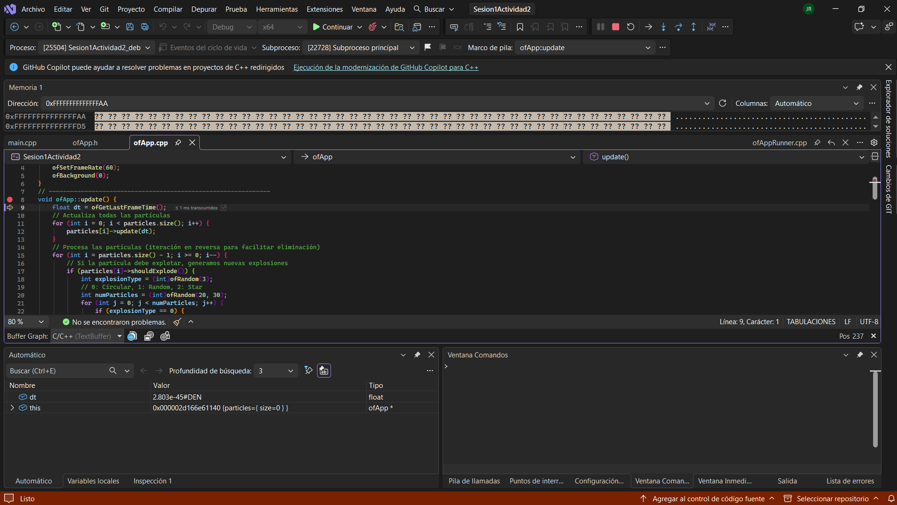
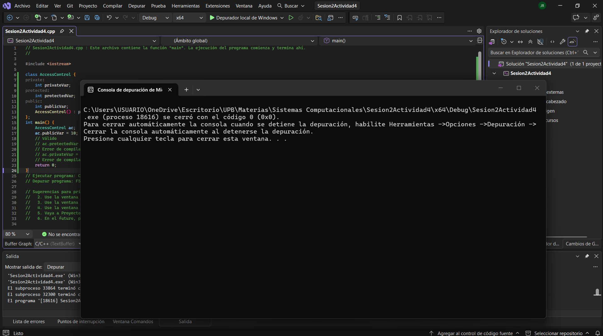
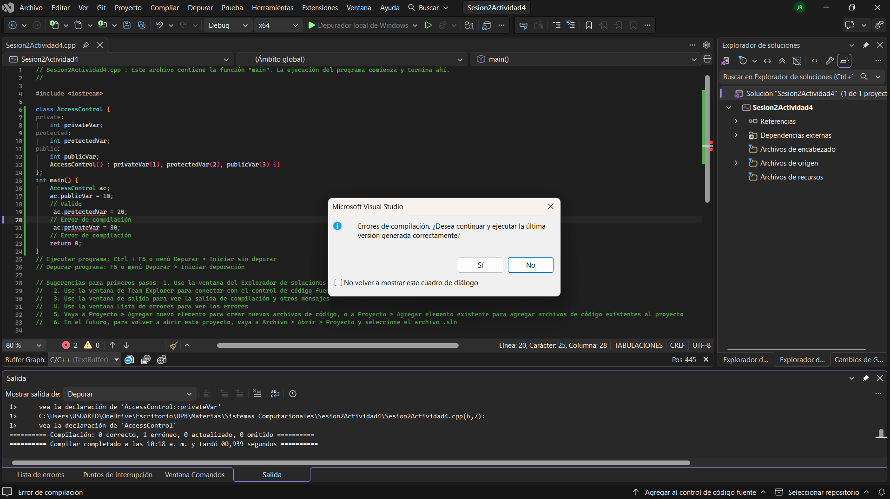
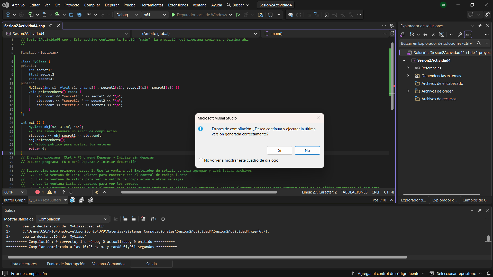

## **Actividad 3**
**¿Qué esperas ver en memoria (hipótesis)?**

- El vector esta almacenando punteros en este caso ```Particle*``` lo que hace que el vector gestione direcciones de memoria que apuntan hacía los datos. A su vez cada que se cree una prticula el objeto se agrega al heap y el vector tendra unicamente las direcciones de memoria de esos objetos.


 
 
**¿Qué puedes observar?**

- Se puede observar como el vector ``` particles``` cambia de tamaño (```size```) a medidda que se llama ```createRisingParticle()```. Tambien se peude obseravar que cada elemento del vector es un codigo hexadecimal (un puntero) y al desaparecer las particulas se peude ver como sus direccioones desaparecen de la  coleccion.

**¿Qué información te proporciona el depurador?**

- El depurador proporciona informacion como: Direcciones de memoria, Tamaño y capacidad del vector y el estado de los atributos.

**Actividad 4**
-

**Ejecuta este código. Luego, descomenta las líneas que están comentadas y vuelve a compilar. ¿Qué sucede? ¿Por qué sucede esto? ¿Qué puedes concluir?**


- 



- Al descomentar las lineas el programa no ejecuta debido a errores en el codigo, esto es debido al encapsulamiento de las variables ya que las dfos que presentan error estan encapsuladas tanto como privada y protected haciendo imposible al programa acceder a ellas.




- Al ejecutar este programa da error debido a que la variable ```secret1``` esta declarar dentro de una clase de tipo private lo que hace sea imposible de acceder desde otra parte del codigo